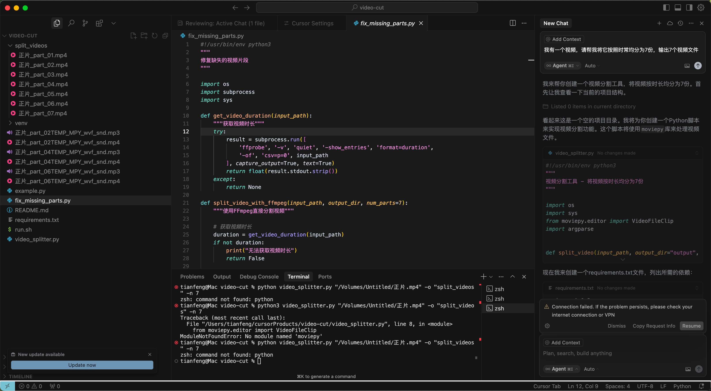

# 让AI给我剪视频

AI帮我剪视频
这里的“剪”，不是“剪辑”，是真的“剪”。我不需要转场、动效、背景音乐等，只需要“按时间等分将原视频剪成n段”。
图 剪刀

网上找了一圈，确实有现成的，但我这视频过大，不是需要付费，就是减不了。我转念一想，这么明确的需求，AI指定可会了。
图 上才艺
第一步，打开cursor,让AI开搞
```html
我有一个视频，请帮我将它按照时常均分为7份，输出7个视频文件
```
第二步，修复下小意外
1. python 改成python3
2. 视频缺几个片段


第三步， 完成


可以看到左侧的split_video中已经生成了7个视频文件，完美完成任务。

AI已经出现两年多了，都想给AI机会，让它做一些事情。有些做好了，有些可能未来会做好，有些可能永远不会。未来不可知，但今天剪视频这个做的挺好的：完成了，没花钱，也没花太多时间。
不过这个题目改一下可能更准确：让AI给我写代码。


