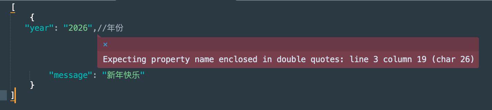
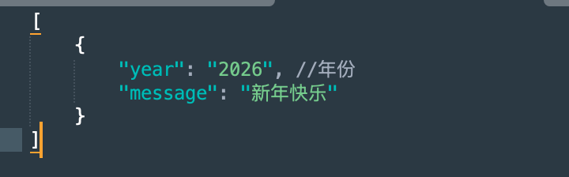
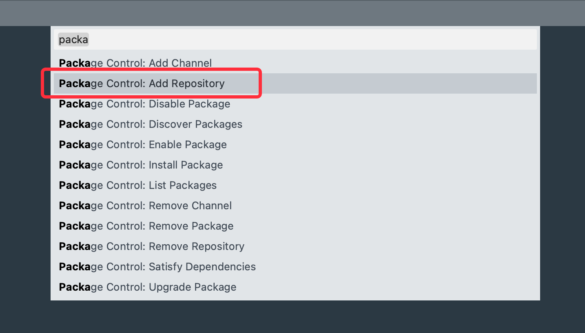
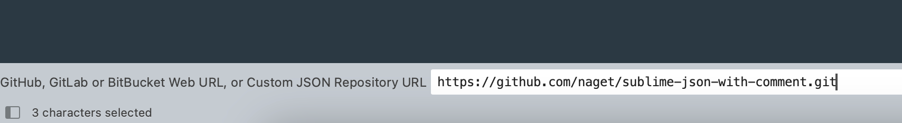
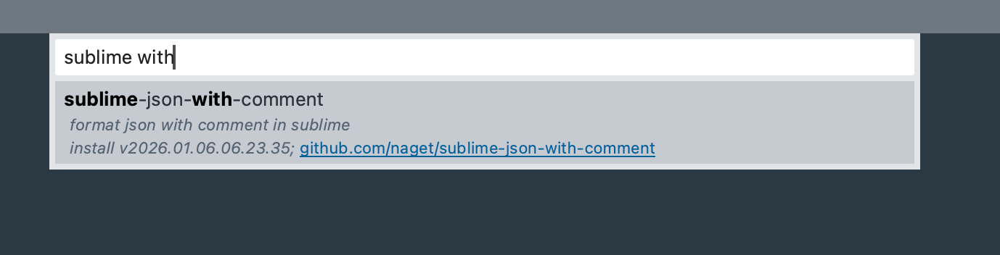

# AI造物·第1弹：开发一个sublime插件

使用sublime格式化json是很多人的日常操作，我常使用的就是pretty json这个插件。但是当json中含有注释时，pretty json插件就会直接报错。

在我的使用场景里，json是写给前端的接口文档，作为一个有追求的程序员，字段怎么能不加注释呢？

### 于是呼
每次格式化的时候，我都把注释删掉，处理完成之后，我再把注释加回来。这个过程一而再，再而三的发生，作为一个有追求的程序员，怎么能让重复的事情一再重复？

### 又于是乎
今天开发了这个插件，准确的说，是我鞭策AI开发了这个插件。它的功能跟pretty json插件差不多，仅仅多加了对注释的支持，可以保留注释的前提下完成json的格式化。

如果需要，大家可以通过以下方式直接使用
1. 拉取插件仓库

    > https://github.com/naget/sublime-json-with-comment.git

2. 安装插件

详情步骤可参考以下链接
> https://github.com/naget/sublime-json-with-comment?tab=readme-ov-file#zh