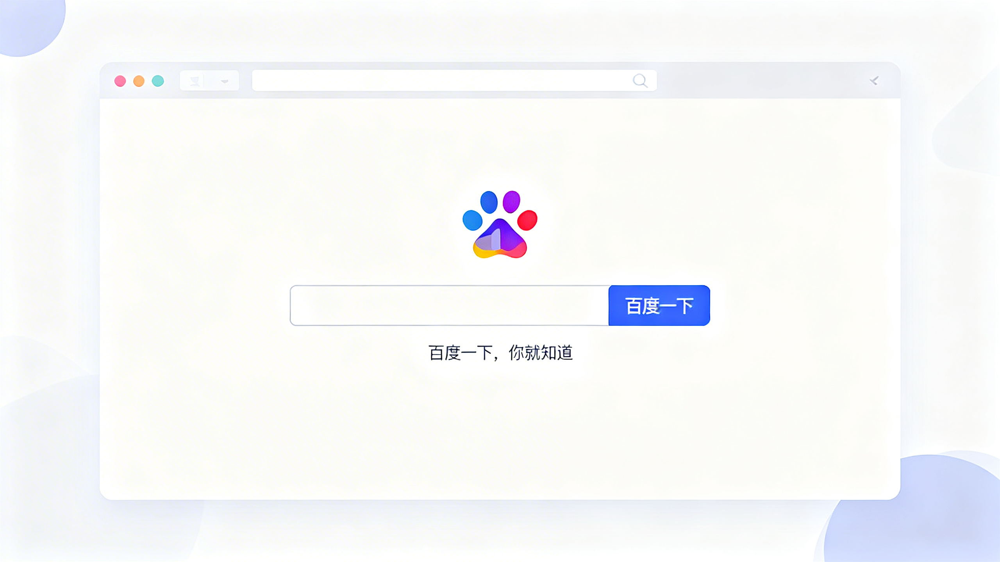
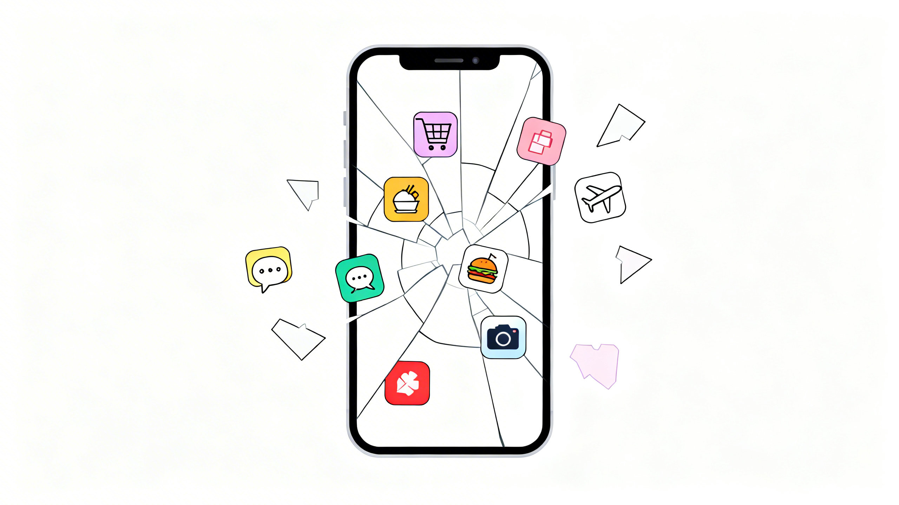
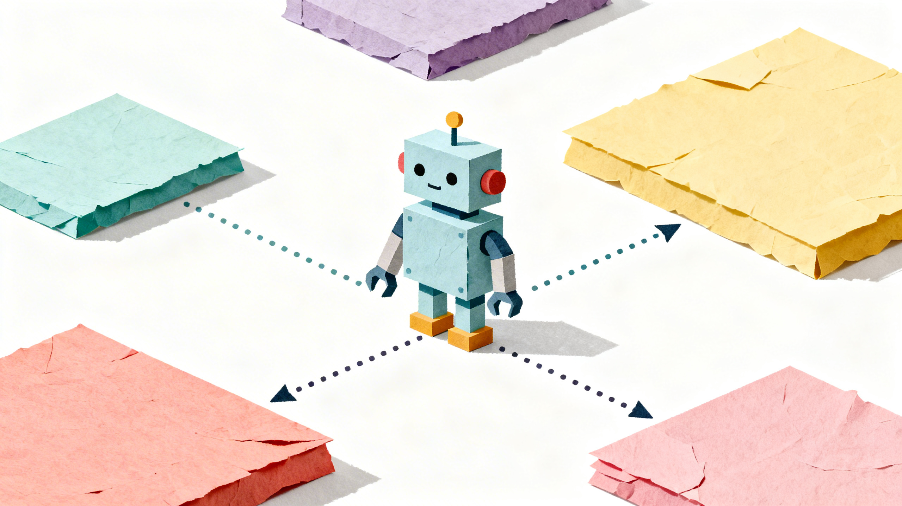

# AI让互联网重新开放

## 一、搜索框的黄金时代

曾经的 PC 时代，百度是互联网绝对的霸主。信息的获取只需一个搜索框，"百度一下，你就知道"是那个时代最自信的承诺。第一次面对那个空白输入框时，我惊诧于它的无所不知——仿佛整个世界的知识都待命于光标之后。彼时正值博客黄金年代，创作者们竞相争夺搜索引擎权重，以被收录、被检索为荣。相信那时的你，也一定曾在搜索框里输入过自己的关键词，期待在结果页中找到自己的痕迹。

---

## 二、移动互联网的割裂

移动互联网来临后，风向陡变。微信、淘宝、今日头条、抖音、小红书纷纷将信息锁进自家 APP，不再向搜索引擎开放接口。曾经开放的互联网碎裂成一座座数据孤岛：出行、用餐、购物、社交，原本连贯的生活被切割成一个个独立的 App。起初我们还会抱怨："这点事也要我下个 App？"然而随着手机内存越扩越大、性能越来越强，抱怨声渐渐消失，我们竟也习惯了在图标之间频繁跳转，仿佛这种碎片化本就是生活的常态。

---

## 三、AI 打破孤岛

当各个巨头终于把互联网分割成完美的私有财产时，AI 的出现却迫使他们重新打开大门——毕竟，再聪明的管家也无法在上了锁的房间里替你拿东西。最近，飞书开源了官方 CLI 工具，允许各类智能体与 AI 无缝接入——不仅能读取数据，更能完成写入文档、预约日程等各种飞书全家桶操作。在当下的 AI 浪潮中，没有厂商敢放弃这个入口。若要让自己的服务被 AI 触及，就必须开放数据接口；若要让 AI 能够替用户使用自己的服务，就必须开放操作接口。当 AI 终于能够跨平台调取这些信息，那些割裂的孤岛似乎正以另一种方式重新相连。十年前亲手把互联网撕成碎片的人，如今，开始教会 AI 如何在废墟间穿梭。

---

## 四、从搜索到 AI

回望那个空白的输入框，它与今天的 AI 对话界面外貌依旧，内核却已天翻地覆。这一次，它真的"什么都知道了"。
